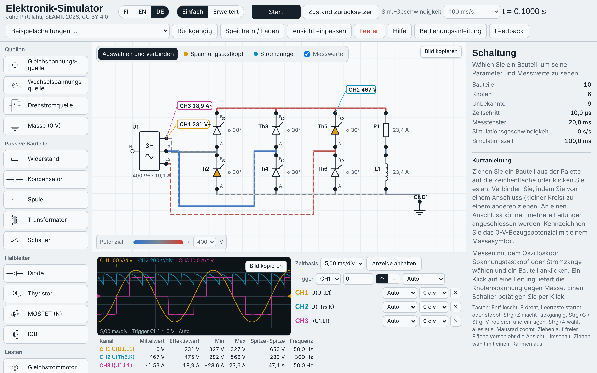
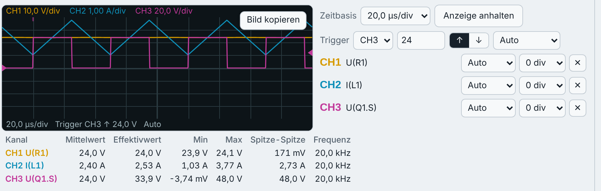

# Elektronik-Simulator – Bedienungsanleitung

> Diese Datei ist die versionierte Kopie der Bedienungsanleitung. Als Webseite: <https://jipirtti.github.io/Elektroniikkasimulaattori/docs/bedienungsanleitung.html>

Juho Pirttilahti, Fachhochschule Seinäjoki (SEAMK), 2026. Konzeption, Inhalt und Validierung: Juho Pirttilahti. Der Programmcode wurde KI-gestützt erstellt (Claude, Anthropic). Lizenz CC BY 4.0.

## Was der Simulator ist

Der Elektronik-Simulator ist ein browserbasiertes Lehrmittel für Gleich- und Wechselstromkreise und Leistungselektronik. Eine Schaltung wird aufgebaut, indem man Bauteile auf die Zeichenfläche zieht und mit Leitungen verbindet. Der Simulator berechnet Spannungen und Ströme im Zeitbereich; gemessen werden sie mit einem Vierkanal-Oszilloskop. Die Messwerte jedes Bauteils (Mittelwert, Effektivwert, Leistung) erscheinen im Eigenschaftenfeld, bei Wechselspannungsquellen außerdem Leistungsfaktor und Oberschwingungsgehalt des Stroms.

Öffnen Sie den Simulator unter <https://jipirtti.github.io/Elektroniikkasimulaattori/?lang=de>. Eine Installation ist nicht nötig. Der Simulator funktioniert auch ohne Netzverbindung, wenn die Datei `index.html` direkt im Browser geöffnet wird.

Der Simulator dient dem Verständnis der Vorgänge. Seine Ergebnisse ersetzen nicht die Auslegungswerkzeuge der Bauteilhersteller (siehe Grenzen des Modells).

## Einfaches und erweitertes Modell

Mit dem Umschalter **Einfach | Erweitert** in der Kopfzeile wird das Simulationsmodell jederzeit gewechselt. Die Schaltung bleibt erhalten, und die Wahl wird im Browser gespeichert. Standard ist das einfache Modell.

| | Einfach | Erweitert |
| --- | --- | --- |
| Zweck | Grundgleichungen lernen: Das Ergebnis entspricht der Lehrbuchformel | Einfluss realer Bauteile: Spannungsabfälle, Kommutierung, Verluste |
| Spannungsquellen | Keine Innenimpedanz | Innenwiderstand; Wechselspannungsquellen auch Induktivität (Kommutierung) |
| Kondensator, Spule | Verlustfrei | Serienwiderstand (ESR), Wicklungswiderstand |
| Transformator | Ideal: U2/U1 = N2/N1, kein Magnetisierungsstrom | Wicklungswiderstände, Streuinduktivität und Hauptinduktivität |
| Diode, Thyristor, IGBT | Idealer Schalter (Durchlasswiderstand 1 mΩ, keine Schleusenspannung) | Schleusenspannung und Durchlasswiderstand, beim Thyristor Haltestrom |
| MOSFET | Idealer Schalter | RDS(on), Schleusenspannung der Body-Diode |
| Ansteuerung | Ohne Totzeit | Totzeit (Einschaltverzögerung) |
| Gleichstrommotor | Keine viskose Reibung | Viskose Reibung |
| Eigenschaftenfeld | Grundparameter | Alle Parameter |

Der Modellwechsel löscht keine Werte: Im erweiterten Modell eingestellte Parameter bleiben erhalten und werden beim Zurückwechseln wieder verwendet.

Modell und Sprache lassen sich im Link voreinstellen: `?mode=simple` oder `?mode=advanced` (auf Finnisch `?malli=yksinkertainen` oder `?malli=kehittynyt`) und `?lang=fi`, `?lang=en` oder `?lang=de`, zum Beispiel <https://jipirtti.github.io/Elektroniikkasimulaattori/?mode=advanced&lang=de>.

**Bei Aufgaben** sollte immer angegeben werden, mit welchem Modell sie zu bearbeiten sind. Ein gutes Vorgehen: den Vorgang von Hand berechnen, mit dem einfachen Modell prüfen und mit dem erweiterten Modell sehen, wie stark reale Bauteile das Ergebnis verändern.

## Aufbau der Ansicht

| Bereich | Inhalt |
| --- | --- |
| Kopfzeile | Sprache (FI, EN, DE), Modell, Start/Pause, Zustand zurücksetzen, Simulationsgeschwindigkeit, Zeit, Beispielschaltungen, Rückgängig, Speichern / Laden, Ansicht einpassen, Leeren, Hilfe, Bedienungsanleitung |
| Palette (links) | Bauteile nach Gruppen: Quellen, passive Bauteile, Halbleiter, Lasten, Messgeräte |
| Zeichenfläche (Mitte) | Schaltung, Werkzeugleiste (Auswählen und verbinden, Spannungstastkopf, Stromzange, Messwerte), Farbskala des Potenzials und Warnungen |
| Eigenschaftenfeld (rechts) | Kennzeichen, Parameter, Messwerte und Auslegungshilfe des gewählten Bauteils; ohne Auswahl Angaben zur Schaltung |
| Oszilloskop (unten) | Bildschirm, Messwerttabelle sowie Einstellungen für Zeitbasis, Trigger und Kanäle |

Die Farbe einer Leitung zeigt das Knotenpotenzial gegen Masse: Grau ist 0 V, Rot positiv und Blau negativ. Die volle Farbe der Skala entspricht der gewählten Spannung (12, 50, 400 oder 800 V). Weiße Striche, die sich entlang einer Leitung bewegen, zeigen die Stromrichtung; ihre Geschwindigkeit wächst mit dem Strom.

## Schaltung aufbauen

### Bauteil hinzufügen und verschieben

1. Ziehen Sie ein Bauteil aus der Palette auf die Zeichenfläche oder klicken Sie es an; es erscheint dann in der Mitte der Ansicht.
2. Verschieben Sie ein Bauteil durch Ziehen. Die Position rastet in einem 10-Pixel-Raster ein.
3. Drehen Sie das gewählte Bauteil mit der Taste R oder der Schaltfläche Um 90° drehen.
4. Löschen Sie das gewählte Bauteil mit der Taste Entf. Die daran angeschlossenen Leitungen und Oszilloskopkanäle werden ebenfalls entfernt.

### Leitungen und Masse

- Eine Leitung verbinden Sie, indem Sie von einem Anschluss (kleiner Kreis) zu einem anderen ziehen. Ein ausgefüllter Kreis bedeutet einen verbundenen Anschluss.
- An einen Anschluss können mehrere Leitungen angeschlossen werden; so entsteht eine Verzweigung. In die Mitte einer Leitung kann nicht angeschlossen werden.
- Leitungen sind ideal: Sie haben weder Widerstand noch Induktivität.
- **Masse** kennzeichnet den 0-V-Bezugspunkt, mit dem Knotenspannungen und Leitungsfarben verglichen werden. Hat die Schaltung keine Masse, wird der Minus- oder N-Anschluss der ersten Quelle als Bezug gewählt, und ein Hinweis erscheint.
- Den Verlauf einer Leitung ändern Sie, indem Sie einen Abschnitt ziehen. Die Enden bleiben verbunden, ein Doppelklick stellt den automatischen Verlauf wieder her.

### Mehrere Bauteile auswählen

- Umschalt+Ziehen auf freier Fläche wählt mit einem Rahmen aus, Umschalt+Klick fügt ein Bauteil hinzu oder entfernt es, Strg+A wählt alles aus und Esc hebt die Auswahl auf.
- Die gewählten Bauteile werden durch Ziehen gemeinsam verschoben. Strg+C und Strg+V kopieren sie mit ihren Parametern und den Leitungen zwischen ihnen. Entf löscht die gewählten Bauteile.

## Bauteile und Parameter

Zählrichtung des Stroms: Bei passiven Bauteilen und Halbleitern ist der Strom positiv, wenn er über Anschluss 1, A, D oder C (bzw. +) in das Bauteil fließt. Bei Quellen ist der Strom positiv, wenn er aus dem Plus- oder L-Anschluss in die Schaltung fließt; die abgegebene Leistung einer Quelle ist daher positiv. Die Spannung wird vom ersten zum zweiten Anschluss gemessen.

| Bauteil | Anschlüsse | Parameter (zusätzliche Parameter des erweiterten Modells kursiv) |
| --- | --- | --- |
| Gleichspannungsquelle | +, − | Spannung U; *Innenwiderstand* |
| Wechselspannungsquelle | L, N | Spannung U (eff.), Frequenz f, Phasenwinkel φ; *Innenwiderstand und innere Induktivität*. u(t) = √2·U·sin(2πft + φ) |
| Drehstromquelle | L1, L2, L3, N | Außenleiterspannung U (eff.), Frequenz, Phasenwinkel; *Innenwiderstand und innere Induktivität je Phase*. Sternschaltung, Strangspannung U/√3, Phasenfolge L1–L2–L3 |
| Masse | 0 | – |
| Widerstand | 1, 2 | Widerstand R |
| Kondensator | 1, 2 | Kapazität C (µF), Anfangsspannung; *ESR* |
| Spule | 1, 2 | Induktivität L (mH), Anfangsstrom; *Wicklungswiderstand* |
| Transformator | 1.1, 1.2 (primär), 2.1, 2.2 (sekundär) | Primäre und sekundäre Bemessungsspannung (Übersetzungsverhältnis N1/N2 = U1/U2); *R1, R2, Streuinduktivität, Hauptinduktivität*. Die Punkte kennzeichnen den Wicklungsanfang (gleiche Polarität) |
| Schalter | 1, 2 | Anfangszustand (offen oder geschlossen); *Kontaktwiderstand*. Ein Klick öffnet oder schließt ihn |
| Diode | A, K | *Schleusenspannung UF0, Durchlasswiderstand, max. Sperrspannung URRM* |
| Thyristor | A, K | Zündung (Zündwinkel, dauernd gezündet oder nicht gezündet), Zündwinkel α, Netzfrequenz; *UT0, Durchlasswiderstand, Haltestrom, max. Sperrspannung* |
| MOSFET (N) | D, S | Ansteuerung (siehe unten), Body-Diode; *RDS(on), Schleusenspannung der Diode, Totzeit, max. Spannung* |
| IGBT | C, E | Ansteuerung, antiparallele Diode; *UCE0, Durchlasswiderstand, Schleusenspannung der Diode, Totzeit, max. Spannung* |
| Gleichstrommotor | +, − | Ankerwiderstand Ra und Ankerinduktivität La, Maschinenkonstante kΦ, Trägheitsmoment J, Lastmoment TL; *viskose Reibung B* |
| Spannungsmesser | +, − | Anzeige DC (Mittelwert) oder AC (Effektivwert). Ideal: belastet die Schaltung nicht |
| Strommesser | +, − | Anzeige DC oder AC. Ideal: kein Spannungsabfall. Wird in Reihe geschaltet |

Die **Auslegungshilfe** im Eigenschaftenfeld berechnet für einen Widerstand den Widerstandswert aus Spannung und Strom, für einen Kondensator die Glättungskapazität eines Gleichrichters C ≈ I / (fr·ΔU) und für eine Spule die Induktivität eines Tiefsetzstellers L = (Ui − Uo)·D / (fs·ΔI). Die Schaltfläche übernimmt das Ergebnis als Parameter.

### Ansteuerung (MOSFET und IGBT)

| Ansteuerung | Funktion |
| --- | --- |
| PWM | Der Schalter leitet zu Beginn der Periode während der Zeit D·T mit T = 1/fs. Die Phase verschiebt die Periode (360° = eine Periode). |
| Sinus-PWM | Ein Dreieckträger (Frequenz fs, −1…+1) wird mit der Referenz m(t) = ma·sin(2π·fm·t + Phase) verglichen. Der Schalter leitet, wenn m(t) > Träger. |
| Dauernd ein / dauernd aus | Konstanter Zustand |

**Invertierte Ansteuerung** kehrt das Signal um, sodass oberer und unterer Schalter desselben Brückenzweigs entgegengesetzte Ansteuerungen erhalten. **Totzeit** verzögert jedes Einschalten um die angegebene Zeit, damit die Schalter eines Zweigs nicht gleichzeitig leiten.

Zum Beispiel erhält man in einer H-Brücke bipolare Sinus-PWM, indem die Schalter Q1 und Q4 dieselbe Ansteuerung und die Schalter Q2 und Q3 die invertierte Ansteuerung erhalten. Die Phasen der Zweige eines dreiphasigen Wechselrichters sind 0°, −120° und −240°.

### Zündwinkel des Thyristors

Der Zündwinkel α wird ab dem Zeitpunkt gemessen, ab dem die Anoden-Kathoden-Spannung des Thyristors positiv wird. In Brückenschaltungen ist das der natürliche Kommutierungszeitpunkt, also der Zeitpunkt, zu dem eine Diode zu leiten beginnen würde. Der Zündimpuls ist breit: Der Thyristor zündet immer, wenn der Zündwinkel verstrichen und die Spannung positiv ist. Für die Synchronisation wird die Netzfrequenz benötigt. Der Thyristor erlischt, wenn der Strom unter den Haltestrom fällt.

## Simulation ausführen

- **Start / Pause** (Leertaste) startet oder stoppt die Simulation. **Zustand zurücksetzen** setzt Kondensatoren und Spulen auf ihre Anfangswerte und die Zeit auf null zurück.
- **Geschwindigkeit** ist die simulierte Zeit je Echtzeitsekunde (1 ms/s – 1 s/s). Kommt die Berechnung nicht nach, läuft die Simulation langsamer; die tatsächliche Geschwindigkeit wird angezeigt, wenn Sie mit der Maus über die Zeit fahren.
- Der **Zeitschritt** wird automatisch gewählt: höchstens 1/2000 einer Netzperiode, 1/200 einer Schaltperiode und 10 µs. Der Wert erscheint in den Angaben zur Schaltung (keine Einstellung).
- **Messfenster**: Mittelwerte, Effektivwerte und Leistungen der Bauteile werden periodenweise berechnet. Das Fenster ist eine Netzperiode (oder die Ausgangsperiode bei Sinus-PWM), bei Gleichstromstellern mindestens 1 ms in ganzen Schaltperioden und bei Gleichstromkreisen 10 ms.

## Oszilloskop

### Kanäle

- Wählen Sie in der Werkzeugleiste **Spannungstastkopf** oder **Stromzange** und klicken Sie ein Bauteil an. Der Spannungstastkopf misst die Spannung am Bauteil, die Stromzange den Strom durch das Bauteil (Zählrichtungen siehe oben).
- Ein Klick mit dem Spannungstastkopf auf eine Leitung oder einen Anschluss misst die Knotenspannung gegen Masse.
- Bei Transformator und Drehstromquelle wird die gemessene Wicklung bzw. Phase danach gewählt, in der Nähe welches Anschlusses Sie klicken. Dasselbe lässt sich mit den Schaltflächen Zum Oszilloskop im Eigenschaftenfeld wählen.
- Es gibt vier Kanäle (CH1 gelb, CH2 cyan, CH3 magenta, CH4 grün). Ein Kanal wird mit der Schaltfläche ✕ entfernt.
- In der Zeichnung zeigt das Etikett eines Kanals den Mittelwert oder bei einem Wechselsignal den Effektivwert (Zeichen ~). Das Etikett lässt sich durch Ziehen verschieben.

### Einstellungen

| Einstellung | Funktion |
| --- | --- |
| Zeitbasis | 1 µs/div – 5 s/div, 10 Teilungen auf dem Bildschirm |
| Skala | V/div oder A/div je Kanal; Auto wählt eine Skala, bei der das Signal in ±4 Teilungen passt |
| Offset | Verschiebt die Nulllinie des Kanals um −4…+4 Teilungen |
| Trigger | Kanal, Pegel (V oder A), Flanke (steigend ↑ oder fallend ↓) |
| Betriebsart | Auto (zeigt die letzte Periode auch ohne Trigger), Normal (aktualisiert nur bei Trigger), Einzeln (hält beim ersten Trigger an), Freilaufend (kein Trigger, zeigt die letzte Zeit) |
| Anzeige anhalten / Start | Friert den Bildschirm ein; die Simulation läuft weiter |

Der Triggerpunkt liegt bei der ersten Teilung des Bildschirms (Markierung am oberen Rand), der Triggerpegel erscheint am rechten Rand als Dreieck in der Kanalfarbe. Bei einem schnell wechselnden Signal (zum Beispiel PWM bei langer Zeitbasis) zeichnet der Bildschirm eine helle Hüllkurve zwischen den Abtastpunkten.

### Messwerttabelle

Die Tabelle berechnet für jeden Kanal über den Bildschirm Mittelwert, Effektivwert, Minimum, Maximum, Spitze-Spitze-Wert und Frequenz. Die Frequenz wird aus steigenden Durchgängen durch den Mittelpegel des Signals berechnet (10 % Hysterese).

## Messwerte und Leistungen

Das Eigenschaftenfeld zeigt die Werte des gewählten Bauteils über das Messfenster:

- Spannung und Strom: Mittelwert und Effektivwert
- Leistung P = Mittelwert(u·i): bei passiven Bauteilen aufgenommene, bei Quellen abgegebene Leistung
- beim Kondensator die Spannungswelligkeit, bei Halbleitern Durchlassverluste, max. Spannung bzw. Sperrspannung und Spitzenstrom
- beim Gleichstrommotor Drehzahl, induzierte Spannung E = kΦ·ω, Moment und Wellenleistung
- beim Transformator primäre und sekundäre Spannung, Strom und Leistung

Bei Wechselspannungsquellen wird zusätzlich per Fourier-Analyse über die Periode berechnet:

| Größe | Definition |
| --- | --- |
| Wirkleistung P | Mittelwert(u·i) |
| Scheinleistung S | Ueff·Ieff |
| Grundschwingungsblindleistung Q1 | U1·I1·sin(φu − φi); positiv bei induktiver Last |
| Leistungsfaktor λ | P/S |
| Verschiebungsfaktor cos φ1 | Kosinus der Phasenverschiebung zwischen den Grundschwingungen von Spannung und Strom |
| THD des Stroms | √(I2² + … + I25²) / I1 (Oberschwingungen 2.–25.) |

## Beispielschaltungen

Die Beispiele werden über das Menü in der Kopfzeile geladen. Das Laden ersetzt die aktuelle Schaltung, Rückgängig stellt sie aber wieder her. In den Beispielen sind Oszilloskopkanäle und Zeitbasis bereits eingestellt. Die erwarteten Werte gelten für das einfache Modell im eingeschwungenen Zustand.

| Beispiel | Was zu sehen ist | Erwarteter Wert (einfach) | Formel |
| --- | --- | --- | --- |
| 1. Spannungsteiler und Aufladung eines RC-Glieds | 12 V, R1 = R2 = 1 kΩ, C = 100 µF. Der Kondensator lädt sich auf die Teilerspannung auf. Öffnen Sie den Schalter, dann entlädt sich der Kondensator über R2. | Uc = 6,0 V, τ = 50 ms | U·R2/(R1 + R2), τ = (R1∥R2)·C |
| 2. RLC-Reihenschwingkreis | 230 V 50 Hz, 10 Ω, 50 mH, 100 µF. Kapazitive Schaltung: Der Strom eilt der Spannung voraus. | I = 12,1 A, P = 1,47 kW, λ = 0,53, Uc = 386 V | I = U/|Z|, cos φ = R/|Z| |
| 3. Einphasige Diodenbrücke (B2) + Kondensator | 24 V, 2200 µF, 47 Ω. Strom aus der Quelle in Impulsen an den Scheitelwerten. | Ud ≈ 32,6 V, Welligkeit ≈ 2,7 V | Û = √2·U = 33,9 V |
| 4. Einphasige Thyristorbrücke (B2C), RL-Last | 230 V, α = 60°, 20 Ω + 200 mH. Nicht lückender Strom, die Gleichspannung wird zeitweise negativ. | Ud = 103,5 V, Id = 5,2 A | Ud = 0,9·U·cos α |
| 5. Dreiphasige Diodenbrücke (B6) | 400 V, 54 Ω. Sechspulsige Welligkeit (300 Hz) der Gleichspannung. | Ud = 540 V, Id = 10 A | Ud = 3√2/π·U = 1,35·U |
| 6. Dreiphasige Thyristorbrücke (B6C) | 400 V, α = 30°, 20 Ω + 200 mH. | Ud = 468 V, Id = 23,4 A | Ud = 1,35·U·cos α |
| 7. Tiefsetzsteller | 48 V, 20 kHz, D = 50 %, 0,22 mH, 100 µF, 10 Ω. | Uo = 24,0 V, ΔIL = 2,7 A | Uo = D·Ui, ΔIL = Ui·D(1 − D)/(L·fs) |
| 8. Hochsetzsteller | 12 V, 20 kHz, D = 50 %, 0,1 mH, 220 µF, 20 Ω. | Uo = 24,0 V | Uo = Ui/(1 − D) |
| 9. Inverswandler (Hoch-Tiefsetzsteller) | 12 V, 20 kHz, D = 60 %, 0,1 mH, 220 µF, 18 Ω. Die Ausgangsspannung ist negativ. | Uo = −18,0 V | Uo = −D/(1 − D)·Ui |
| 10. H-Brücken-Wechselrichter, Sinus-PWM | 300 V, IGBTs, fs = 5 kHz, fm = 50 Hz, ma = 0,8, 10 Ω + 20 mH. Spannungsmesser PV1 misst die Ausgangsspannung. | Û1 = 240 V (U1 = 170 V), I ≈ 14,4 A | Û1 = ma·Udc |
| 11. Dreiphasiger Wechselrichter, Sinus-PWM | 560 V, ma = 0,8, Sternschaltung 10 Ω + 20 mH. PV1 misst die Außenleiterspannung U12. | U12,1 = 274 V, I ≈ 13,4 A | U12,1 = √3/(2√2)·ma·Udc = 0,612·ma·Udc |
| 12. Netzteil mit Transformator | Transformator 230/24 V, Diodenbrücke, 2200 µF, 47 Ω. | U2 = 24 V, Ud ≈ 32,6 V | U2 = U1·N2/N1 |
| 13. Gleichstrommotor mit Gleichstromsteller | 48 V, 10 kHz, D = 50 %, Ra = 1 Ω, kΦ = 0,1 V·s/rad, TL = 0,2 Nm. Der Motor läuft in etwa 0,5 Sekunden hoch. | I = 2,0 A, n = 2100 1/min | I = TL/kΦ, ω = (D·U − Ra·I)/kΦ |

Mit dem erweiterten Modell sind die Werte kleiner: In Beispiel 5 beträgt die Gleichspannung wegen der Schleusenspannungen der Dioden und der Induktivität der Quelle (Kommutierung) etwa 537 V, in Beispiel 7 die Ausgangsspannung etwa 23,4 V.

### Übungsaufgaben

In Klammern steht das Modell, mit dem die Aufgabe bearbeitet werden soll.

1. (Einfach) Beispiel 1: Berechnen Sie die Endspannung des Kondensators und die Zeitkonstante. Messen Sie mit dem Oszilloskop die Zeit, in der die Spannung 63 % des Endwerts erreicht. Öffnen Sie den Schalter: Wie groß ist die Zeitkonstante der Entladung, und warum unterscheidet sie sich von der Aufladung?
2. (Einfach) Beispiel 2: Berechnen Sie Strom, Phasenwinkel und Kondensatorspannung. Finden Sie die Resonanzfrequenz, indem Sie die Frequenz der Quelle ändern. Warum kann die Kondensatorspannung größer sein als die Spannung der Quelle?
3. (Einfach) Beispiel 3: Entfernen Sie den Kondensator. Was geschieht mit dem Mittelwert der Gleichspannung und mit dem THD des Quellenstroms? Legen Sie den Kondensator mit der Auslegungshilfe für eine Welligkeit von 1 V aus.
4. (Beide) Beispiel 5: Vergleichen Sie die Gleichspannung im einfachen und im erweiterten Modell. Berechnen Sie die Anteile von Schleusenspannung und Kommutierung: ΔUd = 2·UF0 + 3ωLk·Id/π.
5. (Einfach) Beispiel 6: Ändern Sie den Zündwinkel von 0° bis 90° und notieren Sie die Gleichspannung. Zeichnen Sie Ud(α) und vergleichen Sie mit der Formel 1,35·U·cos α. Warum lückt der Strom bei großen Winkeln?
6. (Einfach) Beispiel 7: Ändern Sie Tastgrad und Last. Bei welcher Last lückt der Spulenstrom? Berechnen Sie den Grenzwert aus der Bedingung Io = ΔIL/2.
7. (Erweitert) Beispiel 7: Entfernen Sie die Freilaufdiode und verbinden Sie den Source-Anschluss des MOSFET direkt mit der Spule. Was geschieht und warum?
8. (Einfach) Beispiel 10: Ändern Sie den Modulationsgrad von 0,2 bis 1,0 und messen Sie die Grundschwingung der Ausgangsspannung. Was geschieht bei ma > 1 (Übermodulation)?
9. (Erweitert) Beispiel 10: Stellen Sie für die Schalter eine Totzeit von 2 µs ein. Wie zeigt sie sich in der Ausgangsspannung?
10. (Einfach) Beispiel 13: Ändern Sie Tastgrad und Lastmoment. Berechnen Sie die Drehzahl mit der Formel und vergleichen Sie.

## Warnungen

| Warnung | Ursache und Abhilfe |
| --- | --- |
| Die Schaltung ist nicht lösbar | Spannungsquellen oder Strommesser bilden eine Masche, zum Beispiel zwei parallele Spannungsquellen. |
| Die Quelle ist kurzgeschlossen | Beide Anschlüsse einer Quelle oder eines Strommessers liegen am selben Knoten. |
| Spannungsspitze | Ein Spulenstrom wird unterbrochen und hat keinen Strompfad. Fügen Sie eine Freilauf- oder antiparallele Diode hinzu. |
| Sperrspannung bzw. Spannung überschreitet den Bemessungswert | Die Spannung eines Halbleiters überschreitet den Parameter URRM oder die maximale Spannung. |
| Hoher Quellenstrom | Strom der Quelle über 5 kA: auf Kurzschluss prüfen. |
| Die Schaltung hat keine Masse | Hinweis zur Wahl des Bezugspunkts (kein Fehler). |

## Speichern und Weitergeben

Die Schaltung wird automatisch im Browser gespeichert und ist beim erneuten Öffnen der Seite noch vorhanden. **Speichern / Laden** zeigt die Schaltung als Text (JSON). Der Text lässt sich zur Aufbewahrung kopieren, an andere senden oder an ein Feedback-Issue anhängen. Er enthält Bauteile, Leitungen, Oszilloskopkanäle und Einstellungen. Wenn Sie den Text in das Feld einfügen und Laden wählen, wird die Schaltung wiederhergestellt.

## Grenzen des Modells

Die Schaltung wird mit der modifizierten Knotenpunktanalyse (MNA) gelöst. Kondensatoren und Spulen werden mit dem impliziten Euler-Verfahren diskretisiert. Halbleiter sind stückweise linear: im leitenden Zustand Schleusenspannung und Widerstand, im sperrenden Zustand 1 MΩ. In jedem Zeitschritt werden die Schaltzustände iteriert, bis sie mit Spannungen und Strömen widerspruchsfrei sind. Das implizite Euler-Verfahren dämpft Schwingungen leicht; bei Resonanz ist der Strom zum Beispiel etwa 0,5 % kleiner als der analytische Wert.

Das Modell enthält keine Schaltverluste und keine Schaltvorgänge (Halbleiterkapazitäten, Rückwärtserholung), keine Sättigung und Hysterese des Transformators, keine Erwärmung und keinen Widerstand oder keine Induktivität der Leitungen. Die Ergebnisse veranschaulichen die Vorgänge, ersetzen aber nicht die Auslegungswerkzeuge der Bauteilhersteller.

## Tastenkürzel

| Taste | Funktion |
| --- | --- |
| Leertaste | Start oder Pause |
| Entf / Rücktaste | Auswahl löschen |
| R | Auswahl um 90° drehen |
| Strg+Z | Rückgängig |
| Strg+C / Strg+V | Kopieren und Einfügen |
| Strg+A | Alles auswählen |
| Umschalt+Ziehen auf freier Fläche | Rahmenauswahl |
| V oder Esc | Werkzeug Auswählen und verbinden (Esc hebt auch die Auswahl auf) |
| Mausrad | Zoomen |

## Diagramm als Bild kopieren

Jedes Diagramm hat in der Ecke eine Schaltfläche **Bild kopieren**. Sie kopiert das Diagramm als PNG-Bild in die Zwischenablage, das sich direkt in einen Bericht, eine Folie oder eine Nachricht einfügen lässt (Strg+V).

- Das Bild wird immer mit hellem Hintergrund gezeichnet, auch wenn der Simulator ein dunkles Design verwendet, und in doppelter Auflösung.
- Das Bild enthält Diagrammtitel, Diagramm, Legende und Quellenangabe (Name des Simulators, Juho Pirttilahti, SEAMK, CC BY 4.0, Webadresse und Datum).
- Die Schaltflächen befinden sich oben rechts auf der Zeichenfläche (Schaltplan und Farbskala des Potenzials) und oben rechts auf dem Oszilloskopbildschirm. Der Oszilloskopbildschirm behält seinen dunklen Hintergrund.
- Der Schaltplan wird unabhängig von Zoom und sichtbarem Ausschnitt vollständig kopiert. Auswahlrahmen und Hintergrundraster werden weggelassen.
- Erlaubt der Browser das Kopieren in die Zwischenablage nicht, öffnet sich das Bild in einem Fenster. Dort lässt es sich mit der rechten Maustaste (am Telefon durch langes Drücken) kopieren oder als PNG-Datei speichern.

## Autor und Lizenz

Elektronik-Simulator und Bedienungsanleitung: Juho Pirttilahti, Fachhochschule Seinäjoki (SEAMK), 2026. Konzeption, Inhalt und Validierung: Juho Pirttilahti. Der Programmcode wurde KI-gestützt erstellt (Claude, Anthropic).

Das Material steht unter der Lizenz [Creative Commons Namensnennung 4.0 International (CC BY 4.0)](https://creativecommons.org/licenses/by/4.0/deed.de). Sie dürfen das Material für beliebige Zwecke kopieren, weitergeben und bearbeiten, sofern Sie den Autor und die Hochschule nennen, die Lizenz angeben und Ihre Änderungen kenntlich machen.

Quellcode und Feedback: <https://github.com/Jipirtti/Elektroniikkasimulaattori>.
