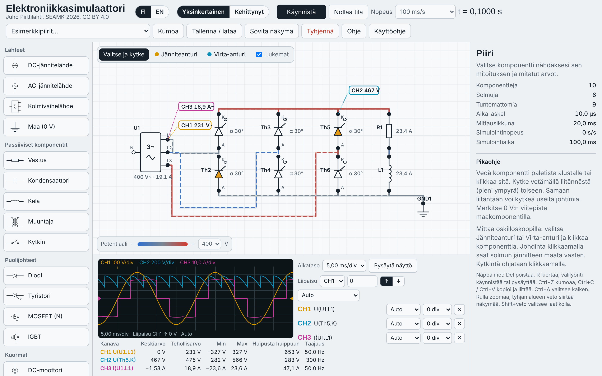
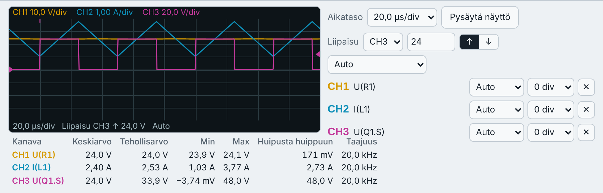

# Elektroniikkasimulaattori – käyttöohje

> Tämä tiedosto on käyttöohjeen versioitu kopio. Verkkosivuna: <https://jipirtti.github.io/Elektroniikkasimulaattori/docs/kayttoohje.html>

Juho Pirttilahti, Seinäjoen ammattikorkeakoulu (SEAMK), 2026. Suunnittelu, sisältö ja validointi: Juho Pirttilahti. Ohjelmakoodi toteutettu tekoälyavusteisesti (Claude, Anthropic). Lisenssi CC BY 4.0.

## Mikä simulaattori on

Elektroniikkasimulaattori on selaimessa toimiva opetusväline DC- ja AC-piireille ja tehoelektroniikalle. Piiri rakennetaan vetämällä komponentteja piirtoalustalle ja kytkemällä ne johtimilla. Simulaattori laskee jännitteet ja virrat aikatasossa, ja niitä mitataan nelikanavaisella oskilloskoopilla. Jokaisen komponentin mitatut arvot (keskiarvo, tehollisarvo, teho) näkyvät ominaisuuspaneelissa, ja AC-lähteistä myös tehokerroin ja virran harmoninen särö.

Avaa simulaattori osoitteessa <https://jipirtti.github.io/Elektroniikkasimulaattori/>. Asennusta ei tarvita. Simulaattori toimii myös avaamalla tiedoston `index.html` suoraan selaimessa ilman verkkoyhteyttä.

Simulaattori on tarkoitettu ilmiöiden ymmärtämiseen. Sen tulokset eivät korvaa komponenttivalmistajien mitoitustyökaluja (ks. Mallin rajoitukset).

## Yksinkertainen ja kehittynyt malli

Yläpalkin valitsimella **Yksinkertainen | Kehittynyt** vaihdetaan simulointimallia lennosta. Piiri säilyy, ja valinta muistetaan selaimessa. Oletuksena on yksinkertainen malli.

| | Yksinkertainen | Kehittynyt |
| --- | --- | --- |
| Tarkoitus | Perusyhtälöiden opettelu: tulos vastaa oppikirjan kaavaa | Todellisten komponenttien vaikutus: jännitehäviöt, kommutointi, häviöt |
| Jännitelähteet | Ei sisäistä impedanssia | Sisäinen resistanssi; AC-lähteillä myös induktanssi (kommutointi) |
| Kondensaattori, kela | Häviöttömät | Sarjaresistanssi (ESR), käämin resistanssi |
| Muuntaja | Ihanteellinen: U2/U1 = N2/N1, ei magnetointivirtaa | Käämien resistanssit, hajainduktanssi ja magnetointi-induktanssi |
| Diodi, tyristori, IGBT | Ihanteellinen kytkin (johtotilan resistanssi 1 mΩ, ei kynnysjännitettä) | Kynnysjännite ja johtotilan resistanssi, tyristorilla pitovirta |
| MOSFET | Ihanteellinen kytkin | RDS(on), rinnakkaisdiodin kynnysjännite |
| Hilaohjaus | Ilman kuollutta aikaa | Kuollut aika (päällekytkennän viive) |
| DC-moottori | Ei viskoosia kitkaa | Viskoosi kitka |
| Ominaisuuspaneeli | Perusparametrit | Kaikki parametrit |

Mallin vaihto ei hävitä arvoja: kehittyneessä mallissa asetetut parametrit säilyvät ja palaavat käyttöön, kun vaihdat takaisin.

Linkkiin voi kirjoittaa mallin ja kielen valmiiksi: `?malli=yksinkertainen` tai `?malli=kehittynyt` (englanniksi `?mode=simple` tai `?mode=advanced`) ja `?lang=fi` tai `?lang=en`, esimerkiksi <https://jipirtti.github.io/Elektroniikkasimulaattori/?malli=kehittynyt>.

**Tehtävissä** kannattaa aina kertoa, kummalla mallilla tehtävä tehdään. Hyvä etenemistapa: laske ilmiö käsin, tarkista se yksinkertaisella mallilla ja katso kehittyneellä mallilla, paljonko todelliset komponentit muuttavat tulosta.

## Näkymän osat

| Alue | Sisältö |
| --- | --- |
| Yläpalkki | Kieli (FI, EN), malli, Käynnistä/Pysäytä, Nollaa tila, simulointinopeus, aika, esimerkkipiirit, Kumoa, Tallenna / lataa, Sovita näkymä, Tyhjennä, Ohje, Käyttöohje |
| Paletti (vasen) | Komponentit ryhmittäin: lähteet, passiiviset komponentit, puolijohteet, kuormat, mittarit |
| Piirtoalusta (keskellä) | Piiri, työkalurivi (Valitse ja kytke, Jänniteanturi, Virta-anturi, Lukemat), potentiaalin väriasteikko ja varoitukset |
| Ominaisuuspaneeli (oikea) | Valitun komponentin tunnus, parametrit, mitatut arvot ja mitoitusapu; ilman valintaa piirin tiedot |
| Oskilloskooppi (alhaalla) | Näyttö, mittaustaulukko sekä aikatason, liipaisun ja kanavien asetukset |

Johtimen väri kertoo solmun potentiaalin maata vasten: harmaa on 0 V, punainen positiivinen ja sininen negatiivinen. Asteikon täysi väri vastaa valittua jännitettä (12, 50, 400 tai 800 V). Johtimessa liikkuvat valkoiset viivat näyttävät virran suunnan, ja niiden nopeus kasvaa virran mukana.

## Piirin rakentaminen

### Komponentin lisääminen ja siirtäminen

1. Vedä komponentti paletista piirtoalustalle tai klikkaa sitä, jolloin se ilmestyy näkymän keskelle.
2. Siirrä komponenttia vetämällä. Sijainti tarttuu 10 pikselin ruudukkoon.
3. Kierrä valittua komponenttia R-näppäimellä tai Kierrä 90° -painikkeella.
4. Poista valittu komponentti Delete-näppäimellä. Siihen liitetyt johtimet ja oskilloskoopin kanavat poistuvat samalla.

### Johtimet ja maa

- Kytke johdin vetämällä liitännästä (pieni ympyrä) toiseen liitäntään. Täytetty ympyrä tarkoittaa kytkettyä liitäntää.
- Samaan liitäntään voi kytkeä useita johtimia, jolloin syntyy haara. Johtimen keskelle ei voi kytkeä.
- Johtimet ovat ihanteellisia: niissä ei ole resistanssia eikä induktanssia.
- **Maa** merkitsee 0 V:n viitepisteen, johon solmujännitteet ja johtimien värit verrataan. Jos piirissä ei ole maata, viitepisteeksi valitaan ensimmäisen lähteen miinusnapa tai N, ja tästä tulee ilmoitus.
- Johtimen reittiä muutetaan vetämällä johtimen osaa. Päät pysyvät kytkettyinä, ja kaksoisklikkaus palauttaa automaattisen reitin.

### Useiden komponenttien valinta

- Shift+veto tyhjästä kohdasta valitsee laatikolla, Shift+klikkaus lisää tai poistaa valinnasta, Ctrl+A valitsee kaiken ja Esc poistaa valinnan.
- Valitut siirtyvät yhdessä vetämällä. Ctrl+C ja Ctrl+V kopioivat ne parametreineen ja niiden väliset johtimet. Delete poistaa valitut.

## Komponentit ja parametrit

Virran mittaussuunta: passiivisilla komponenteilla ja puolijohteilla virta on positiivinen, kun se tulee komponenttiin liitännästä 1, A, D tai C (tai +). Lähteillä virta on positiivinen, kun se lähtee plusnavasta tai L-navasta piiriin, joten lähteen antoteho on positiivinen. Jännite mitataan ensimmäisestä liitännästä toiseen.

| Komponentti | Liitännät | Parametrit (kehittyneen mallin lisäparametrit kursiivilla) |
| --- | --- | --- |
| DC-jännitelähde | +, − | Jännite U; *sisäinen resistanssi* |
| AC-jännitelähde | L, N | Jännite U (tehollisarvo), taajuus f, vaihekulma φ; *sisäinen resistanssi ja induktanssi*. u(t) = √2·U·sin(2πft + φ) |
| Kolmivaihelähde | L1, L2, L3, N | Pääjännite U (tehollisarvo), taajuus, vaihekulma; *sisäinen resistanssi ja induktanssi vaihetta kohti*. Tähtikytkentä, vaihejännite U/√3, vaihejärjestys L1–L2–L3 |
| Maa | 0 | – |
| Vastus | 1, 2 | Resistanssi R |
| Kondensaattori | 1, 2 | Kapasitanssi C (µF), alkujännite; *ESR* |
| Kela | 1, 2 | Induktanssi L (mH), alkuvirta; *käämin resistanssi* |
| Muuntaja | 1.1, 1.2 (ensiö), 2.1, 2.2 (toisio) | Ensiön ja toision nimellisjännite (muuntosuhde N1/N2 = U1/U2); *R1, R2, hajainduktanssi, magnetointi-induktanssi*. Pisteet merkitsevät käämien samaa napaisuutta |
| Kytkin | 1, 2 | Alkutila (auki tai kiinni); *kosketusresistanssi*. Klikkaus avaa tai sulkee |
| Diodi | A, K | *Kynnysjännite UF0, johtotilan resistanssi, suurin estojännite URRM* |
| Tyristori | A, K | Sytytys (ohjauskulma, aina sytytetty tai ei sytytystä), ohjauskulma α, verkon taajuus; *UT0, johtotilan resistanssi, pitovirta, suurin estojännite* |
| MOSFET (N) | D, S | Hilaohjaus (ks. alla), rinnakkaisdiodi; *RDS(on), diodin kynnysjännite, kuollut aika, suurin jännite* |
| IGBT | C, E | Hilaohjaus, vastarinnakkaisdiodi; *UCE0, johtotilan resistanssi, diodin kynnysjännite, kuollut aika, suurin jännite* |
| DC-moottori | +, − | Ankkurin resistanssi Ra ja induktanssi La, moottorivakio kΦ, hitausmomentti J, kuormitusmomentti TL; *viskoosi kitka B* |
| Jännitemittari | +, − | Näyttö DC (keskiarvo) tai AC (tehollisarvo). Ihanteellinen: ei kuormita piiriä |
| Virtamittari | +, − | Näyttö DC tai AC. Ihanteellinen: ei jännitehäviötä. Kytketään sarjaan |

Ominaisuuspaneelin **Mitoitusapu** laskee vastukselle resistanssin jännitteestä ja virrasta, kondensaattorille tasasuuntaajan suodatinkapasitanssin C ≈ I / (fr·ΔU) ja kelalle buck-hakkurin induktanssin L = (Ui − Uo)·D / (fs·ΔI). Painike vie tuloksen parametriksi.

### Hilaohjaus (MOSFET ja IGBT)

| Ohjaus | Toiminta |
| --- | --- |
| PWM | Kytkin johtaa jakson alussa ajan D·T, jossa T = 1/fs. Vaihe siirtää jaksoa (360° = yksi jakso). |
| Sini-PWM | Kolmiokantoaaltoa (taajuus fs, −1…+1) verrataan referenssiin m(t) = ma·sin(2π·fm·t + vaihe). Kytkin johtaa, kun m(t) > kantoaalto. |
| Aina johtava / aina estävä | Vakiotila |

**Käänteinen ohjaus** kääntää signaalin, joten saman haaran ylä- ja alakytkin saavat vastakkaiset ohjaukset. **Kuollut aika** viivästää jokaista päällekytkentää annetulla ajalla, jolloin haaran kytkimet eivät johda yhtä aikaa.

Esimerkiksi H-sillassa bipolaarinen sini-PWM saadaan antamalla kytkimille Q1 ja Q4 sama ohjaus ja kytkimille Q2 ja Q3 käänteinen ohjaus. Kolmivaiheinvertterin haarojen vaiheet ovat 0°, −120° ja −240°.

### Tyristorin ohjauskulma

Ohjauskulma α mitataan siitä hetkestä, kun tyristorin anodi–katodijännite muuttuu positiiviseksi. Siltakytkennöissä tämä on luonnollinen kommutointihetki, eli hetki, jolloin diodi alkaisi johtaa. Sytytyspulssi on leveä: tyristori syttyy aina, kun ohjauskulma on kulunut ja jännite on positiivinen. Tahdistus tarvitsee verkon taajuuden. Tyristori sammuu, kun virta laskee pitovirran alle.

## Simuloinnin ajaminen

- **Käynnistä / Pysäytä** (välilyönti) ajaa tai pysäyttää simuloinnin. **Nollaa tila** palauttaa kondensaattorit ja kelat alkuarvoihin ja ajan nollaan.
- **Nopeus** on simuloitu aika reaaliaikaista sekuntia kohti (1 ms/s – 1 s/s). Jos laskenta ei ehdi, simulointi etenee hitaammin; todellinen nopeus näkyy, kun viet hiiren ajan päälle.
- **Aika-askel** valitaan automaattisesti: enintään 1/2000 verkkojaksosta, 1/200 kytkentäjaksosta ja 10 µs. Arvo näkyy piirin tiedoissa (ei valintaa).
- **Mittausikkuna**: komponenttien keskiarvot, tehollisarvot ja tehot lasketaan jaksoittain. Ikkuna on yksi verkkojakso (tai sini-PWM:n lähtöjakso), hakkureilla vähintään 1 ms kokonaisina kytkentäjaksoina ja DC-piireillä 10 ms.

## Oskilloskooppi

### Kanavat

- Valitse työkaluriviltä **Jänniteanturi** tai **Virta-anturi** ja klikkaa komponenttia. Jänniteanturi mittaa jännitteen komponentin yli, virta-anturi virran sen läpi (suunnat yllä).
- Jänniteanturilla johdinta tai liitäntää klikkaamalla mitataan solmun jännite maata vasten.
- Muuntajalla ja kolmivaihelähteellä mitattava käämi tai vaihe valitaan sen mukaan, mitä liitäntää klikkaat lähimpänä. Saman voi valita ominaisuuspaneelin Oskilloskooppiin-painikkeilla.
- Kanavia on neljä (CH1 keltainen, CH2 syaani, CH3 magenta, CH4 vihreä). Kanavan voi poistaa ✕-painikkeella.
- Piirroksessa kanavan lappu näyttää keskiarvon tai, jos signaali on vaihtosuuntainen, tehollisarvon (merkki ~). Lapun voi siirtää vetämällä.

### Asetukset

| Asetus | Toiminta |
| --- | --- |
| Aikataso | 1 µs/div – 5 s/div, näytössä 10 ruutua |
| Asteikko | Kanavakohtainen V/div tai A/div; Auto valitsee asteikon, jolla signaali mahtuu ±4 ruutuun |
| Siirto | Siirtää kanavan nollatasoa −4…+4 ruutua |
| Liipaisu | Kanava, taso (V tai A), reuna (nouseva ↑ tai laskeva ↓) |
| Tila | Auto (näyttää viimeisimmän jakson myös ilman liipaisua), Normaali (päivittyy vain liipaisusta), Kerta (pysähtyy ensimmäiseen liipaisuun), Vapaa (ei liipaisua, näyttää viimeisimmän ajan) |
| Pysäytä näyttö / Jatka | Jäädyttää näytön; simulointi jatkuu |

Liipaisukohta on näytön ensimmäisen ruudun kohdalla (merkki yläreunassa), ja liipaisutaso näkyy oikeassa reunassa kanavan värisenä kolmiona. Nopeasti vaihtelevan signaalin (esimerkiksi PWM pitkällä aikatasolla) näyttö piirtää vaalealla verhokäyrän näytepisteiden välillä.

### Mittaustaulukko

Taulukko laskee jokaiselle kanavalle näytön ajalta keskiarvon, tehollisarvon, minimin, maksimin, huipusta huippuun -arvon ja taajuuden. Taajuus lasketaan nousevista ylityksistä signaalin keskitasolla (10 %:n hystereesi).

## Mitatut arvot ja tehot

Ominaisuuspaneeli näyttää valitun komponentin arvot mittausikkunan ajalta:

- jännite ja virta: keskiarvo ja tehollisarvo
- teho P = keskiarvo(u·i): passiiviselle komponentille kulutettu teho, lähteelle antoteho
- kondensaattorille jännitteen rippeli, puolijohteille johtohäviöt, suurin jännite tai estojännite ja virran huippuarvo
- DC-moottorille pyörimisnopeus, lähdejännite E = kΦ·ω, momentti ja akseliteho
- muuntajalle ensiön ja toision jännite, virta ja teho

AC-lähteistä lasketaan lisäksi Fourier-analyysillä jakson ajalta:

| Suure | Määritelmä |
| --- | --- |
| Pätöteho P | keskiarvo(u·i) |
| Näennäisteho S | Urms·Irms |
| Perustaajuinen loisteho Q1 | U1·I1·sin(φu − φi); positiivinen induktiivisella kuormalla |
| Tehokerroin λ | P/S |
| Siirtymätehokerroin cos φ1 | jännitteen ja virran perusaaltojen vaihe-eron kosini |
| Virran THD | √(I2² + … + I25²) / I1 (harmoniset 2.–25.) |

## Esimerkkipiirit

Esimerkit ladataan yläpalkin valikosta. Lataus korvaa nykyisen piirin, mutta Kumoa palauttaa sen. Esimerkeissä on valmiina oskilloskoopin kanavat ja aikataso. Odotetut arvot ovat yksinkertaisella mallilla vakiotilassa.

| Esimerkki | Mitä nähdään | Odotettu arvo (yksinkertainen) | Kaava |
| --- | --- | --- | --- |
| 1. Jännitteenjako ja RC-lataus | 12 V, R1 = R2 = 1 kΩ, C = 100 µF. Kondensaattori latautuu jännitteenjaon arvoon. Avaa kytkin, niin kondensaattori purkautuu R2:n kautta. | Uc = 6,0 V, τ = 50 ms | U·R2/(R1 + R2), τ = (R1∥R2)·C |
| 2. RLC-sarjapiiri | 230 V 50 Hz, 10 Ω, 50 mH, 100 µF. Kapasitiivinen piiri: virta edellä jännitettä. | I = 12,1 A, P = 1,47 kW, λ = 0,53, Uc = 386 V | I = U/|Z|, cos φ = R/|Z| |
| 3. Yksivaiheinen diodisilta + kondensaattori | 24 V, 2200 µF, 47 Ω. Virta lähteestä pulsseina huippujen kohdalla. | Ud ≈ 32,6 V, rippeli ≈ 2,7 V | Û = √2·U = 33,9 V |
| 4. Yksivaiheinen tyristorisilta, RL-kuorma | 230 V, α = 60°, 20 Ω + 200 mH. Jatkuva virta, tasajännite käy negatiivisena. | Ud = 103,5 V, Id = 5,2 A | Ud = 0,9·U·cos α |
| 5. Kolmivaiheinen diodisilta (B6) | 400 V, 54 Ω. Tasajännitteessä kuusipulssinen rippeli (300 Hz). | Ud = 540 V, Id = 10 A | Ud = 3√2/π·U = 1,35·U |
| 6. Kolmivaiheinen tyristorisilta (B6C) | 400 V, α = 30°, 20 Ω + 200 mH. | Ud = 468 V, Id = 23,4 A | Ud = 1,35·U·cos α |
| 7. Buck-hakkuri | 48 V, 20 kHz, D = 50 %, 0,22 mH, 100 µF, 10 Ω. | Uo = 24,0 V, ΔIL = 2,7 A | Uo = D·Ui, ΔIL = Ui·D(1 − D)/(L·fs) |
| 8. Boost-hakkuri | 12 V, 20 kHz, D = 50 %, 0,1 mH, 220 µF, 20 Ω. | Uo = 24,0 V | Uo = Ui/(1 − D) |
| 9. Buck-boost-hakkuri | 12 V, 20 kHz, D = 60 %, 0,1 mH, 220 µF, 18 Ω. Lähtöjännite on negatiivinen. | Uo = −18,0 V | Uo = −D/(1 − D)·Ui |
| 10. H-siltainvertteri, sini-PWM | 300 V, IGBT:t, fs = 5 kHz, fm = 50 Hz, ma = 0,8, 10 Ω + 20 mH. Jännitemittari PV1 mittaa lähtöjännitteen. | Û1 = 240 V (U1 = 170 V), I ≈ 14,4 A | Û1 = ma·Udc |
| 11. Kolmivaiheinvertteri, sini-PWM | 560 V, ma = 0,8, tähtikytketty 10 Ω + 20 mH. PV1 mittaa pääjännitteen U12. | U12,1 = 274 V, I ≈ 13,4 A | U12,1 = √3/(2√2)·ma·Udc = 0,612·ma·Udc |
| 12. Muuntajateholähde | 230/24 V muuntaja, diodisilta, 2200 µF, 47 Ω. | U2 = 24 V, Ud ≈ 32,6 V | U2 = U1·N2/N1 |
| 13. DC-moottori ja katkoja | 48 V, 10 kHz, D = 50 %, Ra = 1 Ω, kΦ = 0,1 V·s/rad, TL = 0,2 Nm. Moottori kiihtyy noin 0,5 sekunnissa. | I = 2,0 A, n = 2100 r/min | I = TL/kΦ, ω = (D·U − Ra·I)/kΦ |

Kehittyneellä mallilla arvot ovat pienempiä: esimerkiksi esimerkissä 5 tasajännite on noin 537 V diodien kynnysjännitteiden ja lähteen induktanssin (kommutointi) vuoksi, ja esimerkissä 7 lähtöjännite on noin 23,4 V.

### Harjoitustehtäviä

Suluissa on malli, jolla tehtävä on tarkoitettu tehtäväksi.

1. (Yksinkertainen) Esimerkki 1: laske kondensaattorin loppujännite ja aikavakio. Mittaa oskilloskoopilla aika, jossa jännite saavuttaa 63 % loppuarvosta. Avaa kytkin: mikä on purkautumisen aikavakio, ja miksi se eroaa latauksesta?
2. (Yksinkertainen) Esimerkki 2: laske virta, vaihekulma ja kondensaattorin jännite. Etsi resonanssitaajuus muuttamalla lähteen taajuutta. Miksi kondensaattorin jännite voi olla suurempi kuin lähteen jännite?
3. (Yksinkertainen) Esimerkki 3: poista kondensaattori. Mitä tapahtuu tasajännitteen keskiarvolle ja lähteen virran THD:lle? Mitoita kondensaattori mitoitusavulla 1 V:n rippelille.
4. (Molemmat) Esimerkki 5: vertaa tasajännitettä yksinkertaisella ja kehittyneellä mallilla. Laske diodien kynnysjännitteen ja kommutoinnin osuudet: ΔUd = 2·UF0 + 3ωLk·Id/π.
5. (Yksinkertainen) Esimerkki 6: muuta ohjauskulmaa 0°:sta 90°:een ja kirjaa tasajännite. Piirrä Ud(α) ja vertaa kaavaan 1,35·U·cos α. Miksi virta muuttuu epäjatkuvaksi suurilla kulmilla?
6. (Yksinkertainen) Esimerkki 7: muuta pulssisuhdetta ja kuormaa. Millä kuormalla kelan virta muuttuu epäjatkuvaksi? Laske raja-arvo ehdosta Io = ΔIL/2.
7. (Kehittynyt) Esimerkki 7: poista vapaakytkentädiodi ja kytke MOSFETin lähde suoraan kelaan. Mitä tapahtuu ja miksi?
8. (Yksinkertainen) Esimerkki 10: muuta modulaatioindeksiä 0,2:sta 1,0:aan ja mittaa lähtöjännitteen perusaalto. Mitä tapahtuu, kun ma > 1 (ylimodulointi)?
9. (Kehittynyt) Esimerkki 10: aseta kytkimille 2 µs kuollut aika. Miten se näkyy lähtöjännitteessä?
10. (Yksinkertainen) Esimerkki 13: muuta pulssisuhdetta ja kuormitusmomenttia. Laske pyörimisnopeus kaavalla ja vertaa.

## Varoitukset

| Varoitus | Syy ja korjaus |
| --- | --- |
| Piiriä ei voi ratkaista | Jännitelähteet tai virtamittarit muodostavat silmukan, esimerkiksi kaksi jännitelähdettä rinnakkain. |
| Lähde on oikosuljettu | Lähteen tai virtamittarin molemmat navat ovat samassa solmussa. |
| Jännitepiikki | Kelan virta katkeaa, eikä sillä ole kulkureittiä. Lisää vapaakytkentädiodi tai vastarinnakkaisdiodi. |
| Estojännite tai jännite ylittää sallitun | Puolijohteen jännite ylittää parametrin URRM tai suurimman jännitteen. |
| Lähteen virta suuri | Lähteen virta yli 5 kA: tarkista oikosulku. |
| Piirissä ei ole maata | Ilmoitus viitepisteen valinnasta (ei virhe). |

## Tallennus ja jakaminen

Piiri tallentuu automaattisesti selaimeen, ja se on tallessa, kun avaat sivun uudelleen. **Tallenna / lataa** näyttää piirin tekstinä (JSON). Tekstin voi kopioida talteen, lähettää toiselle tai liittää palauteissueen. Teksti sisältää komponentit, johtimet, oskilloskoopin kanavat ja asetukset. Liittämällä tekstin kenttään ja valitsemalla Lataa piiri palautuu.

## Mallin rajoitukset

Piiri ratkaistaan muunnellulla solmupistemenetelmällä (MNA). Kondensaattorit ja kelat diskretoidaan implisiittisellä Eulerin menetelmällä. Puolijohteet ovat paloittain lineaarisia: johtavana kynnysjännite ja resistanssi, estävänä 1 MΩ. Jokaisella aika-askeleella kytkentätilat iteroidaan, kunnes ne ovat ristiriidattomia jännitteiden ja virtojen kanssa. Implisiittinen Euler vaimentaa hieman värähtelyjä; esimerkiksi resonanssissa virta on noin 0,5 % pienempi kuin analyyttinen arvo.

Mallissa ei ole kytkentähäviöitä eikä kytkentätransientteja (puolijohteiden kapasitanssit, takavirta), muuntajan kyllästymistä ja hystereesiä, lämpenemistä eikä johtimien resistanssia ja induktanssia. Tulokset kuvaavat ilmiöitä, mutta eivät korvaa komponenttivalmistajien mitoitustyökaluja.

## Pikanäppäimet

| Näppäin | Toiminto |
| --- | --- |
| Välilyönti | Käynnistä tai pysäytä |
| Delete / Backspace | Poista valitut |
| R | Kierrä valittua 90° |
| Ctrl+Z | Kumoa |
| Ctrl+C / Ctrl+V | Kopioi ja liitä |
| Ctrl+A | Valitse kaikki |
| Shift+veto tyhjästä | Laatikkovalinta |
| V tai Esc | Valitse ja kytke -työkalu (Esc poistaa myös valinnan) |
| Hiiren rulla | Zoomaus |

## Tekijä ja lisenssi

Elektroniikkasimulaattori ja käyttöohje: Juho Pirttilahti, Seinäjoen ammattikorkeakoulu (SEAMK), 2026. Suunnittelu, sisältö ja validointi: Juho Pirttilahti. Ohjelmakoodi toteutettu tekoälyavusteisesti (Claude, Anthropic).

Aineisto on lisensoitu [Creative Commons Nimeä 4.0 Kansainvälinen -lisenssillä (CC BY 4.0)](https://creativecommons.org/licenses/by/4.0/deed.fi). Saat kopioida, jakaa ja muokata aineistoa mihin tahansa tarkoitukseen, kunhan mainitset tekijän ja oppilaitoksen, merkitset lisenssin ja kerrot tekemistäsi muutoksista.

Lähdekoodi ja palaute: <https://github.com/Jipirtti/Elektroniikkasimulaattori>.
