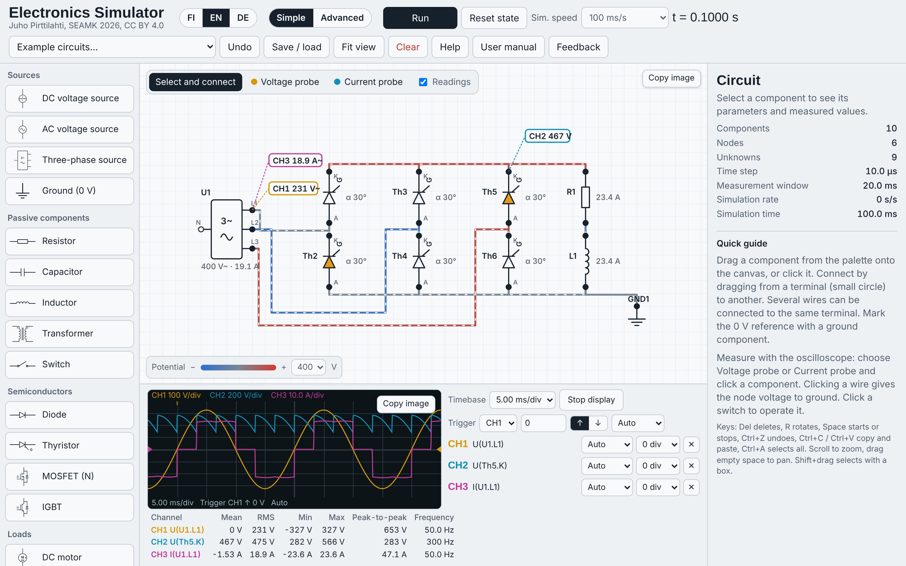
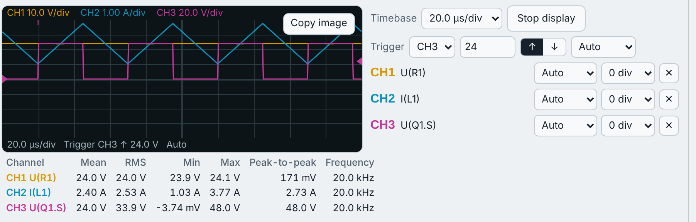

# Electronics Simulator – user manual

> This file is the versioned copy of the user manual. As a web page: <https://jipirtti.github.io/Elektroniikkasimulaattori/docs/user-manual.html>

Juho Pirttilahti, Seinäjoki University of Applied Sciences (SEAMK), 2026. Design, content and validation: Juho Pirttilahti. Code implemented with AI assistance (Claude, Anthropic). Licence CC BY 4.0.

## What the simulator is

The Electronics Simulator is a browser-based teaching tool for DC and AC circuits and power electronics. A circuit is built by dragging components onto the canvas and connecting them with wires. The simulator calculates the voltages and currents in the time domain, and they are measured with a four-channel oscilloscope. The measured values of every component (mean, RMS, power) are shown in the properties panel, and for AC sources also the power factor and the current harmonic distortion.

Open the simulator at <https://jipirtti.github.io/Elektroniikkasimulaattori/?lang=en>. No installation is needed. The simulator also works offline by opening the file `index.html` directly in a browser.

The simulator is intended for understanding phenomena. Its results do not replace component manufacturers' design tools (see Model limitations).

## Simple and advanced model

The **Simple | Advanced** toggle in the header switches the simulation model on the fly. The circuit is kept, and the choice is remembered in the browser. The default is the simple model.

| | Simple | Advanced |
| --- | --- | --- |
| Purpose | Learning the basic equations: the result matches the textbook formula | The effect of real components: voltage drops, commutation, losses |
| Voltage sources | No internal impedance | Internal resistance; AC sources also inductance (commutation) |
| Capacitor, inductor | Lossless | Series resistance (ESR), winding resistance |
| Transformer | Ideal: U2/U1 = N2/N1, no magnetising current | Winding resistances, leakage inductance and magnetising inductance |
| Diode, thyristor, IGBT | Ideal switch (on-state resistance 1 mΩ, no threshold voltage) | Threshold voltage and on-state resistance, holding current for the thyristor |
| MOSFET | Ideal switch | RDS(on), body diode threshold voltage |
| Gate drive | No dead time | Dead time (turn-on delay) |
| DC motor | No viscous friction | Viscous friction |
| Properties panel | Basic parameters | All parameters |

Switching the model does not lose values: parameters set in the advanced model are kept and come back into use when you switch back.

The model and the language can be preset in the link: `?mode=simple` or `?mode=advanced` (in Finnish `?malli=yksinkertainen` or `?malli=kehittynyt`) and `?lang=fi`, `?lang=en` or `?lang=de`, for example <https://jipirtti.github.io/Elektroniikkasimulaattori/?mode=advanced&lang=en>.

**In assignments**, always state which model the task is to be done with. A good way to proceed: calculate the phenomenon by hand, check it with the simple model and see with the advanced model how much real components change the result.

## Parts of the view

| Area | Content |
| --- | --- |
| Header | Language (FI, EN, DE), model, Run/Pause, Reset state, simulation speed, time, example circuits, Undo, Save / load, Fit view, Clear, Help, User manual |
| Palette (left) | Components by group: sources, passive components, semiconductors, loads, meters |
| Canvas (centre) | The circuit, the toolbar (Select and connect, Voltage probe, Current probe, Readings), the potential colour scale and warnings |
| Properties panel (right) | Tag, parameters, measured values and sizing helper of the selected component; circuit information when nothing is selected |
| Oscilloscope (bottom) | Screen, measurement table and the timebase, trigger and channel settings |

The colour of a wire shows the node potential to ground: grey is 0 V, red positive and blue negative. The full colour of the scale corresponds to the chosen voltage (12, 50, 400 or 800 V). White dashes moving along a wire show the direction of the current, and their speed increases with the current.

## Building a circuit

### Adding and moving a component

1. Drag a component from the palette onto the canvas, or click it, and it appears in the middle of the view.
2. Move a component by dragging. The position snaps to a 10-pixel grid.
3. Rotate the selected component with the R key or the Rotate 90° button.
4. Delete the selected component with the Delete key. The wires and oscilloscope channels attached to it are removed as well.

### Wires and ground

- Connect a wire by dragging from a terminal (small circle) to another terminal. A filled circle means a connected terminal.
- Several wires can be connected to the same terminal, creating a branch. A wire cannot be connected to the middle of another wire.
- Wires are ideal: they have no resistance and no inductance.
- **Ground** marks the 0 V reference point to which the node voltages and wire colours are compared. If the circuit has no ground, the negative or N terminal of the first source is chosen as the reference, and a notice says so.
- Reshape the route of a wire by dragging a section of it. The ends stay connected, and a double-click restores the automatic route.

### Selecting several components

- Shift+drag from an empty spot selects with a box, Shift+click adds or removes a component, Ctrl+A selects all and Esc clears the selection.
- The selected components move together by dragging. Ctrl+C and Ctrl+V copy them with their parameters and the wires between them. Delete removes the selected components.

## Components and parameters

Current measurement direction: for passive components and semiconductors the current is positive when it enters the component through terminal 1, A, D or C (or +). For sources the current is positive when it leaves the plus or L terminal into the circuit, so the power delivered by a source is positive. Voltage is measured from the first terminal to the second.

| Component | Terminals | Parameters (additional parameters of the advanced model in italics) |
| --- | --- | --- |
| DC voltage source | +, − | Voltage U; *internal resistance* |
| AC voltage source | L, N | Voltage U (rms), frequency f, phase angle φ; *internal resistance and inductance*. u(t) = √2·U·sin(2πft + φ) |
| Three-phase source | L1, L2, L3, N | Line voltage U (rms), frequency, phase angle; *internal resistance and inductance per phase*. Star connection, phase voltage U/√3, phase sequence L1–L2–L3 |
| Ground | 0 | – |
| Resistor | 1, 2 | Resistance R |
| Capacitor | 1, 2 | Capacitance C (µF), initial voltage; *ESR* |
| Inductor | 1, 2 | Inductance L (mH), initial current; *winding resistance* |
| Transformer | 1.1, 1.2 (primary), 2.1, 2.2 (secondary) | Rated primary and secondary voltage (turns ratio N1/N2 = U1/U2); *R1, R2, leakage inductance, magnetising inductance*. The dots mark the same polarity of the windings |
| Switch | 1, 2 | Initial state (open or closed); *contact resistance*. A click opens or closes it |
| Diode | A, K | *Threshold voltage UF0, on-state resistance, max. reverse voltage URRM* |
| Thyristor | A, K | Firing (firing angle, always fired or not fired), firing angle α, mains frequency; *UT0, on-state resistance, holding current, max. blocking voltage* |
| MOSFET (N) | D, S | Gate drive (see below), body diode; *RDS(on), diode threshold voltage, dead time, max. voltage* |
| IGBT | C, E | Gate drive, antiparallel diode; *UCE0, on-state resistance, diode threshold voltage, dead time, max. voltage* |
| DC motor | +, − | Armature resistance Ra and inductance La, motor constant kΦ, moment of inertia J, load torque TL; *viscous friction B* |
| Voltmeter | +, − | Display DC (mean) or AC (rms). Ideal: does not load the circuit |
| Ammeter | +, − | Display DC or AC. Ideal: no voltage drop. Connected in series |

The **Sizing helper** in the properties panel calculates the resistance of a resistor from voltage and current, the rectifier filter capacitance C ≈ I / (fr·ΔU) for a capacitor and the buck converter inductance L = (Ui − Uo)·D / (fs·ΔI) for an inductor. The button copies the result into the parameter.

### Gate drive (MOSFET and IGBT)

| Drive | Operation |
| --- | --- |
| PWM | The switch conducts at the start of the period for the time D·T, where T = 1/fs. The phase shifts the period (360° = one period). |
| Sine PWM | A triangular carrier (frequency fs, −1…+1) is compared with the reference m(t) = ma·sin(2π·fm·t + phase). The switch conducts when m(t) > carrier. |
| Always on / always off | Constant state |

**Inverted drive** inverts the signal, so the upper and lower switches of the same leg get opposite drives. **Dead time** delays every turn-on by the given time, so the switches of a leg do not conduct at the same time.

For example, bipolar sine PWM in an H-bridge is obtained by giving switches Q1 and Q4 the same drive and switches Q2 and Q3 the inverted drive. The phases of the legs of a three-phase inverter are 0°, −120° and −240°.

### Thyristor firing angle

The firing angle α is measured from the instant at which the anode–cathode voltage of the thyristor becomes positive. In bridge circuits this is the natural commutation instant, that is, the instant at which a diode would start to conduct. The gate pulse is wide: the thyristor always fires when the firing angle has elapsed and the voltage is positive. Synchronisation needs the mains frequency. The thyristor turns off when the current falls below the holding current.

## Running the simulation

- **Run / Pause** (Space) runs or stops the simulation. **Reset state** returns capacitors and inductors to their initial values and the time to zero.
- **Speed** is the simulated time per real-time second (1 ms/s – 1 s/s). If the calculation cannot keep up, the simulation runs more slowly; the actual rate is shown when you hover over the time.
- The **time step** is chosen automatically: at most 1/2000 of a mains period, 1/200 of a switching period and 10 µs. The value is shown in the circuit information (no setting).
- **Measurement window**: the means, RMS values and powers of the components are calculated period by period. The window is one mains period (or the output period of sine PWM), for converters at least 1 ms in whole switching periods, and 10 ms for DC circuits.

## Oscilloscope

### Channels

- Choose **Voltage probe** or **Current probe** on the toolbar and click a component. The voltage probe measures the voltage across the component, the current probe the current through it (directions above).
- Clicking a wire or a terminal with the voltage probe measures the node voltage to ground.
- For a transformer and a three-phase source, the winding or phase measured is chosen by which terminal you click nearest. The same can be chosen with the To oscilloscope buttons in the properties panel.
- There are four channels (CH1 yellow, CH2 cyan, CH3 magenta, CH4 green). A channel is removed with the ✕ button.
- On the drawing, the label of a channel shows the mean or, if the signal is alternating, the RMS value (marked ~). The label can be moved by dragging.

### Settings

| Setting | Operation |
| --- | --- |
| Timebase | 1 µs/div – 5 s/div, 10 divisions on the screen |
| Scale | V/div or A/div per channel; Auto chooses a scale at which the signal fits within ±4 divisions |
| Offset | Moves the zero level of the channel by −4…+4 divisions |
| Trigger | Channel, level (V or A), edge (rising ↑ or falling ↓) |
| Mode | Auto (shows the latest period even without a trigger), Normal (updates only on a trigger), Single (stops at the first trigger), Free run (no trigger, shows the latest time) |
| Stop display / Run | Freezes the screen; the simulation continues |

The trigger point is at the first division of the screen (mark at the top edge), and the trigger level is shown at the right edge as a triangle in the channel colour. For a fast-changing signal (for example PWM on a long timebase) the screen draws a light envelope between the sample points.

### Measurement table

For each channel the table calculates the mean, RMS, minimum, maximum, peak-to-peak value and frequency over the screen. The frequency is calculated from rising crossings at the mid-level of the signal (10 % hysteresis).

## Measured values and powers

The properties panel shows the values of the selected component over the measurement window:

- voltage and current: mean and RMS value
- power P = mean(u·i): consumed power for a passive component, delivered power for a source
- voltage ripple for a capacitor; conduction losses, max. voltage or reverse voltage and peak current for semiconductors
- speed, back EMF E = kΦ·ω, torque and shaft power for a DC motor
- primary and secondary voltage, current and power for a transformer

For AC sources, Fourier analysis over the period also gives:

| Quantity | Definition |
| --- | --- |
| Active power P | mean(u·i) |
| Apparent power S | Urms·Irms |
| Fundamental reactive power Q1 | U1·I1·sin(φu − φi); positive for an inductive load |
| Power factor λ | P/S |
| Displacement factor cos φ1 | cosine of the phase difference between the fundamentals of voltage and current |
| Current THD | √(I2² + … + I25²) / I1 (harmonics 2nd–25th) |

## Example circuits

The examples are loaded from the menu in the header. Loading replaces the current circuit, but Undo restores it. The examples have the oscilloscope channels and timebase ready. The expected values are for the simple model in steady state.

| Example | What is seen | Expected value (simple) | Formula |
| --- | --- | --- | --- |
| 1. Voltage divider and RC charging | 12 V, R1 = R2 = 1 kΩ, C = 100 µF. The capacitor charges to the divider voltage. Open the switch and the capacitor discharges through R2. | Uc = 6.0 V, τ = 50 ms | U·R2/(R1 + R2), τ = (R1∥R2)·C |
| 2. Series RLC circuit | 230 V 50 Hz, 10 Ω, 50 mH, 100 µF. A capacitive circuit: the current leads the voltage. | I = 12.1 A, P = 1.47 kW, λ = 0.53, Uc = 386 V | I = U/|Z|, cos φ = R/|Z| |
| 3. Single-phase diode bridge + capacitor | 24 V, 2200 µF, 47 Ω. Current from the source in pulses at the peaks. | Ud ≈ 32.6 V, ripple ≈ 2.7 V | Û = √2·U = 33.9 V |
| 4. Single-phase thyristor bridge, RL load | 230 V, α = 60°, 20 Ω + 200 mH. Continuous current, the DC voltage goes negative. | Ud = 103.5 V, Id = 5.2 A | Ud = 0.9·U·cos α |
| 5. Three-phase diode bridge (B6) | 400 V, 54 Ω. Six-pulse ripple (300 Hz) on the DC voltage. | Ud = 540 V, Id = 10 A | Ud = 3√2/π·U = 1.35·U |
| 6. Three-phase thyristor bridge (B6C) | 400 V, α = 30°, 20 Ω + 200 mH. | Ud = 468 V, Id = 23.4 A | Ud = 1.35·U·cos α |
| 7. Buck converter | 48 V, 20 kHz, D = 50 %, 0.22 mH, 100 µF, 10 Ω. | Uo = 24.0 V, ΔIL = 2.7 A | Uo = D·Ui, ΔIL = Ui·D(1 − D)/(L·fs) |
| 8. Boost converter | 12 V, 20 kHz, D = 50 %, 0.1 mH, 220 µF, 20 Ω. | Uo = 24.0 V | Uo = Ui/(1 − D) |
| 9. Buck-boost converter | 12 V, 20 kHz, D = 60 %, 0.1 mH, 220 µF, 18 Ω. The output voltage is negative. | Uo = −18.0 V | Uo = −D/(1 − D)·Ui |
| 10. H-bridge inverter, sine PWM | 300 V, IGBTs, fs = 5 kHz, fm = 50 Hz, ma = 0.8, 10 Ω + 20 mH. Voltmeter PV1 measures the output voltage. | Û1 = 240 V (U1 = 170 V), I ≈ 14.4 A | Û1 = ma·Udc |
| 11. Three-phase inverter, sine PWM | 560 V, ma = 0.8, star-connected 10 Ω + 20 mH. PV1 measures the line voltage U12. | U12,1 = 274 V, I ≈ 13.4 A | U12,1 = √3/(2√2)·ma·Udc = 0.612·ma·Udc |
| 12. Transformer power supply | 230/24 V transformer, diode bridge, 2200 µF, 47 Ω. | U2 = 24 V, Ud ≈ 32.6 V | U2 = U1·N2/N1 |
| 13. DC motor with a chopper | 48 V, 10 kHz, D = 50 %, Ra = 1 Ω, kΦ = 0.1 V·s/rad, TL = 0.2 Nm. The motor accelerates in about 0.5 seconds. | I = 2.0 A, n = 2100 rpm | I = TL/kΦ, ω = (D·U − Ra·I)/kΦ |

With the advanced model the values are lower: for example in example 5 the DC voltage is about 537 V because of the diode threshold voltages and the source inductance (commutation), and in example 7 the output voltage is about 23.4 V.

### Exercises

The model intended for the exercise is given in brackets.

1. (Simple) Example 1: calculate the final voltage of the capacitor and the time constant. Measure with the oscilloscope the time in which the voltage reaches 63 % of the final value. Open the switch: what is the time constant of the discharge, and why does it differ from charging?
2. (Simple) Example 2: calculate the current, phase angle and capacitor voltage. Find the resonant frequency by changing the source frequency. Why can the capacitor voltage be higher than the source voltage?
3. (Simple) Example 3: remove the capacitor. What happens to the mean DC voltage and to the THD of the source current? Size the capacitor with the sizing helper for a ripple of 1 V.
4. (Both) Example 5: compare the DC voltage with the simple and the advanced model. Calculate the shares of the diode threshold voltage and of commutation: ΔUd = 2·UF0 + 3ωLk·Id/π.
5. (Simple) Example 6: change the firing angle from 0° to 90° and record the DC voltage. Plot Ud(α) and compare with the formula 1.35·U·cos α. Why does the current become discontinuous at large angles?
6. (Simple) Example 7: change the duty cycle and the load. At which load does the inductor current become discontinuous? Calculate the limit from the condition Io = ΔIL/2.
7. (Advanced) Example 7: remove the freewheeling diode and connect the MOSFET source directly to the inductor. What happens and why?
8. (Simple) Example 10: change the modulation index from 0.2 to 1.0 and measure the fundamental of the output voltage. What happens when ma > 1 (overmodulation)?
9. (Advanced) Example 10: set a dead time of 2 µs for the switches. How does it show in the output voltage?
10. (Simple) Example 13: change the duty cycle and the load torque. Calculate the speed with the formula and compare.

## Warnings

| Warning | Cause and remedy |
| --- | --- |
| The circuit cannot be solved | Voltage sources or ammeters form a loop, for example two voltage sources in parallel. |
| The source is short-circuited | Both terminals of a source or ammeter are on the same node. |
| Voltage spike | An inductor current is interrupted and has no path. Add a freewheeling or antiparallel diode. |
| Reverse voltage or voltage exceeds the rated value | The voltage of a semiconductor exceeds the parameter URRM or the maximum voltage. |
| High source current | Source current above 5 kA: check for a short circuit. |
| The circuit has no ground | Notice about the choice of reference point (not an error). |

## Saving and sharing

The circuit is saved automatically in the browser and is there when you open the page again. **Save / load** shows the circuit as text (JSON). The text can be copied for safekeeping, sent to someone else or attached to a feedback issue. It contains the components, wires, oscilloscope channels and settings. Pasting the text into the field and choosing Load restores the circuit.

## Model limitations

The circuit is solved with modified nodal analysis (MNA). Capacitors and inductors are discretised with the implicit Euler method. Semiconductors are piecewise linear: threshold voltage and resistance when conducting, 1 MΩ when blocking. At each time step the switching states are iterated until they are consistent with the voltages and currents. Implicit Euler damps oscillations slightly; for example, at resonance the current is about 0.5 % lower than the analytical value.

The model has no switching losses or switching transients (semiconductor capacitances, reverse recovery), no transformer saturation or hysteresis, no heating and no wire resistance or inductance. The results illustrate the phenomena but do not replace component manufacturers' design tools.

## Keyboard shortcuts

| Key | Function |
| --- | --- |
| Space | Run or pause |
| Delete / Backspace | Delete selected |
| R | Rotate selected by 90° |
| Ctrl+Z | Undo |
| Ctrl+C / Ctrl+V | Copy and paste |
| Ctrl+A | Select all |
| Shift+drag from an empty spot | Box selection |
| V or Esc | Select and connect tool (Esc also clears the selection) |
| Mouse wheel | Zoom |

## Copying a chart as an image

Every chart has a **Copy image** button in its corner. It copies the chart to the clipboard as a PNG image that can be pasted directly into a report, a slide or a message (Ctrl+V).

- The image is always drawn on a light background, even when the simulator is in a dark theme, and at double resolution.
- The image contains the chart title, the chart, the legend and a source note (simulator name, Juho Pirttilahti, SEAMK, CC BY 4.0, web address and date).
- The buttons are in the top right corner of the canvas (circuit diagram and potential colour scale) and in the top right corner of the oscilloscope screen. The oscilloscope screen keeps its dark background.
- The whole circuit diagram is copied regardless of the zoom and the visible area. Selection frames and the background grid are left out.
- If the browser does not allow copying to the clipboard, the image opens in a window. From there it can be copied with the right mouse button (on a phone with a long press) or saved as a PNG file.

## Author and licence

Electronics Simulator and user manual: Juho Pirttilahti, Seinäjoki University of Applied Sciences (SEAMK), 2026. Design, content and validation: Juho Pirttilahti. Code implemented with AI assistance (Claude, Anthropic).

The material is licensed under the [Creative Commons Attribution 4.0 International licence (CC BY 4.0)](https://creativecommons.org/licenses/by/4.0/). You may copy, share and adapt the material for any purpose, provided you credit the author and the institution, indicate the licence and state your changes.

Source code and feedback: <https://github.com/Jipirtti/Elektroniikkasimulaattori>.
